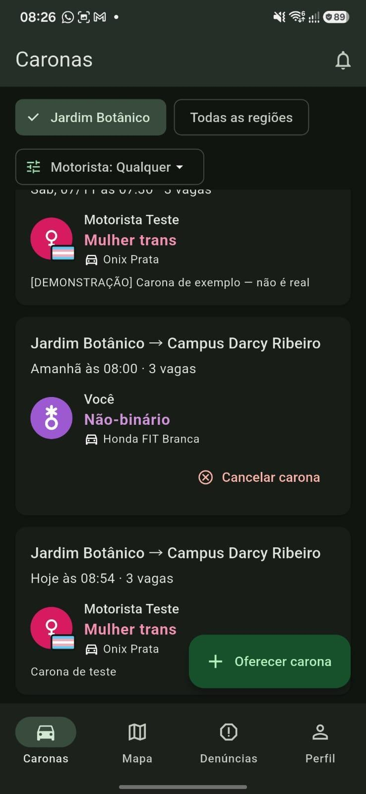
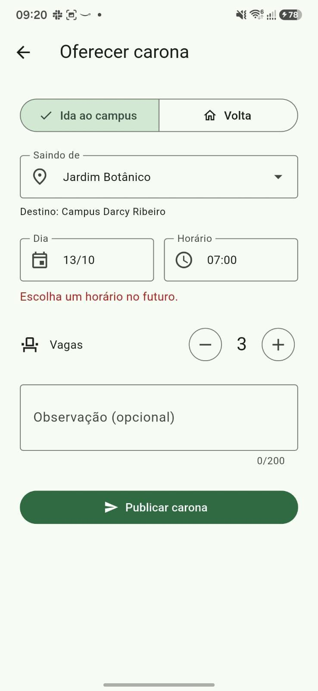
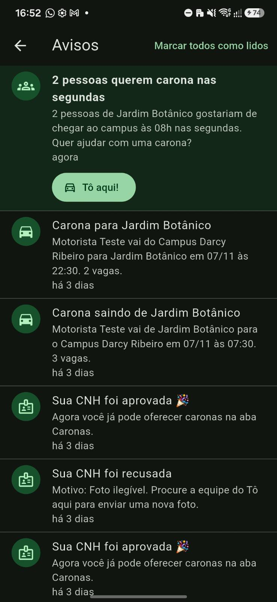
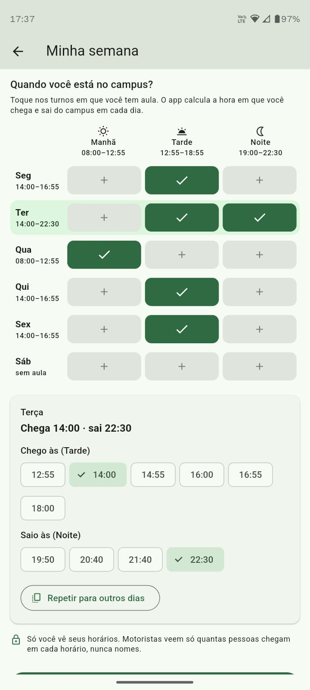
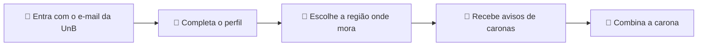

<div align="center">

# 📍 Tô aqui UnB

### Carona entre estudantes na UnB, de carro e a pé 🚗🚶

[](https://bruno-nicholas.github.io/)


</div>

---

## ✨ Sobre o projeto

O **Tô aqui UnB** é um aplicativo que conecta estudantes da Universidade de Brasília para dividir caronas até o **Campus Darcy Ribeiro**, na volta para casa e também dentro do campus.

A ideia é simples: **gastar menos, chegar mais rápido e conhecer gente nova no caminho**, em um ambiente seguro, já que o acesso é restrito a quem tem e-mail institucional `@aluno.unb.br`.

> 💡 Este repositório contém a **landing page** do projeto, publicada com GitHub Pages.

---

## 🚀 Funcionalidades

| | Recurso | O que faz |
|---|---|---|
| 🔐 | **Login sem senha** | Código enviado por e-mail, com sessão de 7 dias |
| 🗺️ | **Caronas por região** | Filtro por região e por tipo de motorista |
| 🔔 | **Avisos no sininho** | Alertas de caronas na região e pedidos de carona, com o botão "Tô aqui!" |
| 📅 | **Minha semana** | O estudante marca seus turnos de aula e só ele vê os horários |
| 💜 | **Grupos de afinidade** | Identificação do motorista e caronas exclusivas, como só para mulheres |
| 🪪 | **Motoristas verificados** | Só quem tem a CNH aprovada pode oferecer caronas |
| 🚩 | **Canal de denúncias** | A equipe analisa cada caso, sem advertência automática |

---

## 📱 Telas do aplicativo

<div align="center">

<table>
  <tr>
    <td align="center"><br><sub><b>Lista de caronas</b></sub></td>
    <td align="center"><br><sub><b>Oferecer carona</b></sub></td>
    <td align="center"><br><sub><b>Central de avisos</b></sub></td>
    <td align="center"><br><sub><b>Minha semana</b></sub></td>
  </tr>
</table>

<sub>Capturas reais da versão atual, com dados de teste.</sub>

</div>

---

## 🧭 Como funciona



---

## 🛠️ Andamento do projeto

| Etapa | Foco | Situação |
|:---:|---|---|
| 1 | Identificação e verificação | ✅ Em funcionamento |
| 2 | Banco de dados e conexões | 🔄 Em andamento |
| 3 | Mapeamento e rotas | 🚧 Em construção |
| 4 | Segurança e denúncia | 🟡 Primeira versão |

---

## 💻 Tecnologias

- 📱 **Flutter (Dart)** no aplicativo, testado no navegador e em Android
- 🗄️ **Supabase** para autenticação, banco de dados e regras de acesso
- 🗺️ **Leaflet** para o mapa (previsto)

---

## 📂 Sobre este repositório

```text
.
├── index.html   # página do projeto
└── img/         # capturas de tela do aplicativo
```

<details>
<summary><b>✏️ Como alterar um texto da página</b></summary>

<br>

1. Abra o arquivo `index.html` neste repositório.
2. Clique no ícone de lápis (**Edit this file**).
3. Altere o texto e clique em **Commit changes**.
4. Em 1 a 3 minutos o site é atualizado.

</details>

---

## 👥 Equipe

| | Integrante |
|---|---|
| 👤 | Belphon Linardy Bahm Kiminu |
| 👤 | Bruno Nicholas Marques da Silva |
| 👤 | Caio Leal Vargas |
| 👤 | Felipe Akira Furrier Serikava |
| 👤 | Henrique Vasconcelos Ribeiro de Oliveira |
| 👤 | Pedro Abílio Cruzeiro Moreira |
| 👤 | Vitor Gabriel Carvalho Souza |

🎓 **Orientação:** professor Edson Mintsu Hung

<div align="center">

<sub>Projeto Integrador de Fundamentos · Universidade de Brasília · 2026</sub>

</div>
